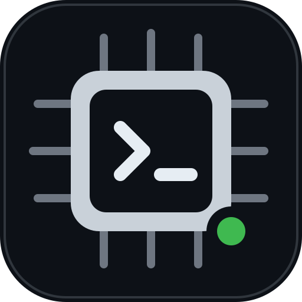

<div align="center">



# greymicroagent

**A private AI assistant that runs on your own computer.**

Ask a question in a local chat window, add your own documents, and get answers without an account, a cloud service, or telemetry.

[](https://github.com/greyok00/greymicroagent/releases)
[](LICENSE)
[](#requirements)
[](https://www.python.org/)

[Overview](#overview) · [Quick start](#quick-start) · [Documents](#teach-it-your-documents) · [Privacy](#privacy) · [Troubleshooting](#troubleshooting)

</div>

---

## Overview

greymicroagent is a small, local AI assistant. The model runs on the same
machine as the chat window, and the optional document layer turns your own
PDFs, text files, markdown files and web pages into a searchable knowledge
base. Nothing is sent to a company, there is no account to create, and the
assistant only goes online when you explicitly ask for a web search.

The whole product is designed for a normal desktop:

| Piece | What it does |
|---|---|
| **Chat** | A local text window with a resident 2B model |
| **Documents** | `/rag` commands add, remove and search your own material |
| **Web research** | Optional direct search, or a local SearXNG helper |
| **Runtime** | Local model server, grounding gate and context compressor on private local ports |

## Requirements

- A 64-bit Linux or Windows computer with about 4 GB of free memory and 2 GB
  of free disk space.
- Python 3.13 or newer and Node.js 22 or newer. The Windows launcher can
  install both on first start; the Linux instructions below install them
  explicitly.
- Two files from the [Releases page](https://github.com/greyok00/greymicroagent/releases):
  the model file `qwen3.5-2b-abliterated.gguf` (about 1.2 GB) and the program
  archive for your system.

Every release uses the same model file, so it only needs to be downloaded once.
`THIRD-PARTY-NOTICES.txt` is the license bundle and is not needed to run the
program.

## Quick start

### Linux: Debian package

```bash
# Node.js 22 and Python 3.13, when not already installed
curl -fsSL https://deb.nodesource.com/setup_22.x | sudo -E bash -
sudo apt install -y nodejs
sudo add-apt-repository ppa:deadsnakes/ppa
sudo apt update
sudo apt install -y python3.13

# Install the release package
sudo apt install ./greymicroagent_0.7.5.1_amd64.deb

# Give the assistant its model
mkdir -p ~/.greymicroagent/models
mv qwen3.5-2b-abliterated.gguf ~/.greymicroagent/models/

greymicroagent
```

### Linux: folder

```bash
mkdir greymicroagent
tar -xzf greymicroagent_0.7.5.1_linux-x86_64.tar.gz -C greymicroagent
mv qwen3.5-2b-abliterated.gguf greymicroagent/model/
cd greymicroagent
./launch.sh
```

If a piece is still missing, run `./package/greymicroagent.sh` once. It installs
the remaining local pieces and starts the program.

### Windows

1. Download the `.zip` and the model file from Releases.
2. Extract the archive.
3. Put the model at
   `%USERPROFILE%\.greymicroagent\models\qwen3.5-2b-abliterated.gguf`.
4. Right-click `launch.ps1` and choose **Run with PowerShell**. If Windows
   blocks it, run:

```powershell
powershell -ExecutionPolicy Bypass -File .\launch.ps1
```

The first start installs the local support runtime if needed. Later starts are
fast. The Windows launcher can use a Vulkan-capable GPU when one is available;
the CPU path remains the fallback. `GREYAGENT_NGL` pins offloaded layers and
`GREYAGENT_THREADS` pins the CPU thread count.

### Let an AI assistant install it

If you already use a coding assistant, paste this into it:

```text
Install greymicroagent from its public release.
Release page: https://github.com/greyok00/greymicroagent/releases/tag/v0.7.5.1
Download greymicroagent_0.7.5.1_linux-x86_64.tar.gz and qwen3.5-2b-abliterated.gguf.
Install Python 3.13 or newer and Node.js 22 or newer if they are missing.
Unpack the archive into a folder named greymicroagent, then put the model file
in that folder's model directory.
Verify the model with: python3 scripts/fetch_model.py verify
Stop and tell me if that check fails.
Start the program with ./launch.sh and report what you see.
Do not edit anything inside the state directory.
```

## Talking to it

Type a question and press Enter. The first answer can take a minute while the
model loads; later answers are faster.

The bottom of the window shows three small panels: conversation compression,
recent activity and answer speed.

## Teach it your documents

These commands work in the Linux version. `/rag` is shorthand for retrieval
augmented generation.

| Command | What it does |
|---|---|
| `/rag status` | Show what the assistant already knows |
| `/rag ingest <address or file>` | Add one web page, PDF, text file or markdown file; asks before saving |
| `/rag remove <word>` | Show what would be deleted; repeat the command to delete |
| `/rag offline on` | Answer only from your own documents |
| `/rag offline off` | Also allow the model's general knowledge |
| `/rag temp 0.1` | Set answer temperature from `0.0` (strict) to `0.2` (looser) |

A document is added only after confirmation, and a deletion happens only when
the same remove command is repeated. Nothing changes silently.

## How it works

One session starts three small local services on a private range of local
ports, `7640` to `7647`:

- the model server;
- a grounding gate that adds your documents to each question;
- a compressor that shortens long tool output.

The ports are chosen automatically so two copies can run side by side. Program
files are listed in `state/MANIFEST.json`, which is checked at every start; a
damaged installation refuses to run rather than answering from a broken tree.
Deep web research works best with a local SearXNG instance, but direct search
is available without one.

## Privacy

Answers are produced on your computer. Nothing is sent anywhere unless you
ask for a web search. There is no account, no telemetry and no cloud service.
The model file is local, the document index is local, and the runtime talks to
`127.0.0.1` only.

## Troubleshooting

| What you see | What to do |
|---|---|
| `command not found: greymicroagent` | The package is not installed; use the folder option or install the `.deb` |
| `model missing` | Put the model in `~/.greymicroagent/models/` or the folder's `model/` directory |
| `model size` or `hash` mismatch | The download is incomplete; download the model again |
| `all sessions in use` | Two copies are already running; close one |
| `frozen tree` | A program file changed after install; download the release again |
| Node.js or Python `too old` | Install Node.js 22 and Python 3.13 |
| `launch.ps1` cannot be loaded | Run the PowerShell command shown in the Windows steps |

## Credits

The starter knowledge base is built from [tldr-pages](https://github.com/tldr-pages/tldr),
licensed CC-BY-4.0. The model server is llama.cpp (MIT). SlimToken handles
request compression and patchright drives page reading for deep research. Full
third-party license texts ship in `THIRD-PARTY-NOTICES.txt`.

## License

Apache License 2.0. See [LICENSE](LICENSE).
